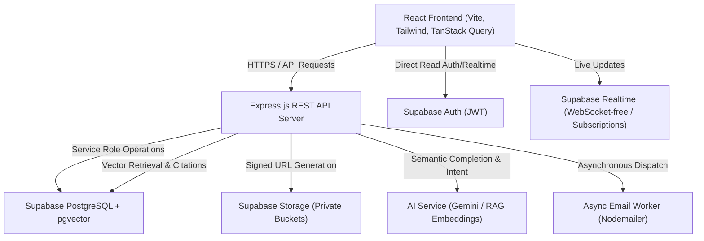
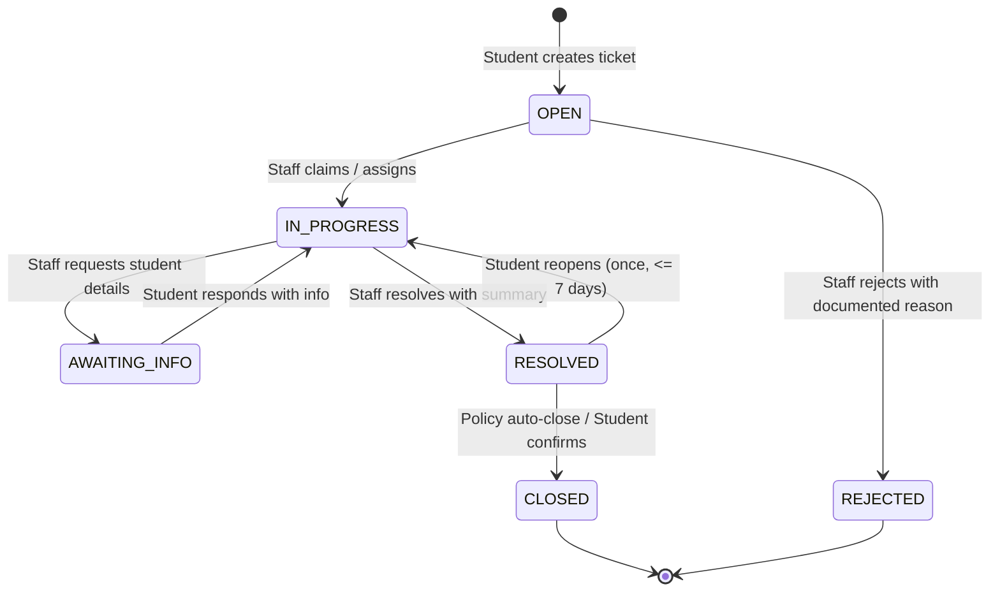
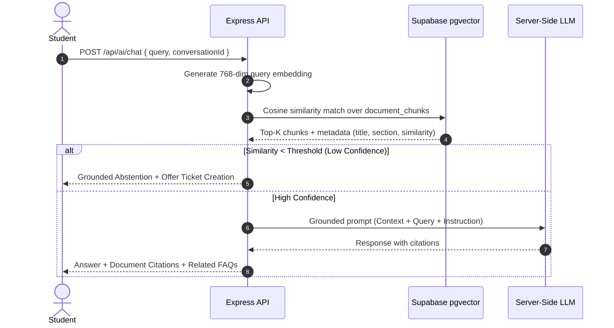

# SmartDesk — System Architecture & Design Document

## 1. System Overview
SmartDesk is an enterprise-grade AI-powered college student help desk application engineered to provide grounded academic, administrative, and logistical assistance. It pairs a Retrieval-Augmented Generation (RAG) assistant with a formal ticketing lifecycle, role-based access control, departmental routing, and SLA tracking.



## 2. Security Boundaries & Authorization Matrix
1. **Student Boundary**:
   - Access limited strictly to own tickets (`created_by = auth.uid()`).
   - May only read public comments on own tickets (`is_internal = false`).
   - May not view other students' tickets, profiles, or uploaded attachments.
2. **Staff Boundary**:
   - Must be approved (`status = 'APPROVED'`).
   - Access restricted to tickets assigned to their department (`department_id`).
   - May create and view internal notes (`is_internal = true`).
   - Confidential grievances restricted to designated Grievance Officers.
3. **Super Admin Boundary**:
   - System-wide governance: approvals, departments, categories, SLAs, system announcements, audit logs.
   - Operations performed strictly via authenticated server-side endpoints with audit logging.
4. **Client-Side Untrusted Role Principle**:
   - Never trust roles from client headers or payloads. All authorization checks verify the user profile record against database records in PostgreSQL via Row Level Security (RLS) and server middleware.

## 3. Ticket Lifecycle State Machine


## 4. AI & RAG Pipeline Architecture


## 5. API Response Envelope Specification
All endpoints adhere to a standardized JSON envelope:
```json
{
  "success": true,
  "message": "Human readable summary of action",
  "data": {}
}
```
In case of error:
```json
{
  "success": false,
  "message": "Clear explanation of the error",
  "error": {
    "code": "VALIDATION_ERROR",
    "details": []
  }
}
```
